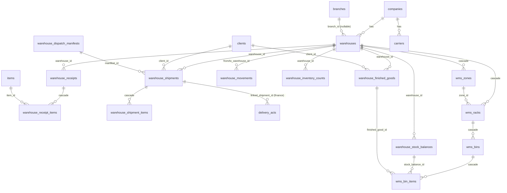
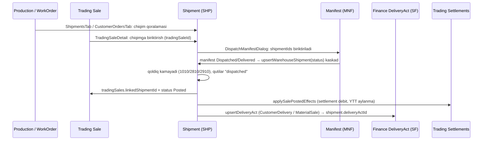
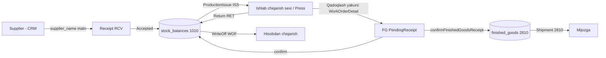
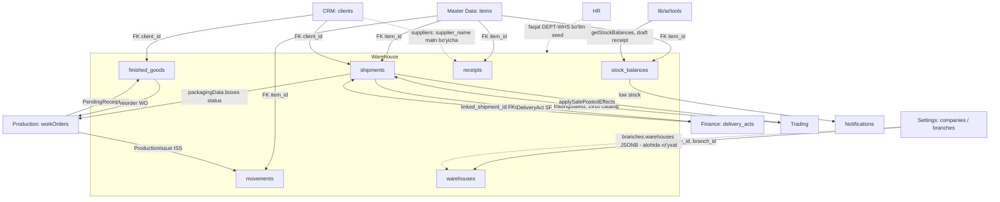

# Warehouse moduli — Arxitektura xaritasi

> Maqsad: Warehouse (Ombor) modulini keyingi tahlil, refaktoring va bug-fix ishlarida tez tushunish uchun yagona ma'lumotnoma.
> Holat: `master` @ `c19d3ef` (2026-11-12). Kod o'zgarganda ushbu fayl ham yangilanishi kerak.

---

## 1. Qisqacha

Warehouse — PrintGoo ERP ning **moddiy oqim markazi**. U 1C uslubidagi "jamg'arish registri" (accumulation register) g'oyasiga asoslangan: hujjatlar (kirim, chiqim, ko'chirish, inventarizatsiya) **tasdiqlangan statusga** o'tganda qoldiq jadvallariga delta yoziladi.

Uchta buxgalteriya hisobi bo'yicha qoldiq yuritiladi:

| Hisob | Ma'nosi | Qoldiq jadvali |
|---|---|---|
| `1010` | Xomashyo (qog'oz, bo'yoq, plyonka...) | `warehouse_stock_balances` |
| `2810` | Tayyor mahsulot (ishlab chiqarishdan) | `warehouse_finished_goods` (+ `warehouse_stock_balances` ga ham yoziladi, 9-bo'limga qarang) |
| `2910` | Savdo tovarlari / aksessuarlar | `trading_catalog.stock_qty` (Trading moduliga tegishli jadval) |

---

## 2. Qatlamlar va fayllar xaritasi

```
UI (Next.js client)                 State                  API (route handlers)              Servis (server)                 DB (Drizzle / Postgres)
──────────────────────────          ───────────────        ─────────────────────────         ──────────────────────          ─────────────────────────
lib/modules.ts (menyu)          ┐
components/layout/                │
  RegistryGridRenderer.tsx  ──────┤   store/               app/api/v1/warehouse/*            lib/server/
  Workspace.tsx (doc tablar)      ├─► workspaceStore.ts ─► route.ts (GET/POST/DELETE)  ───►  warehouseService.ts  ───────►  db/schema/warehouse.ts
components/grid/WarehouseGrid.tsx │   (fetch + optimistic)                                    wmsService.ts                  (+ core, master, crm,
components/documents/Warehouse*   │                                                          numberingService.ts             finance, trading,
components/documents/warehouse/   ┘                                                          notificationService.ts          production)
  dialogs/*, wms/*
```

### 2.1 Menyu tuzilmasi (`lib/modules.ts:151`)

| Bo'lim | Sub-modul id | Grid / View |
|---|---|---|
| **Inventory** (`stock`) | `stock-balance` | `WarehouseGrid type="stock-balance"` |
| | `finished-goods` | `WarehouseGrid type="finished-goods"` |
| | `trading-catalog` | Trading moduli gridi (2910) |
| | `requirements` | `WarehouseGrid type="requirements"` (MRP defitsit, client-side) |
| | `wms-map` | `WarehouseWmsView` |
| **Documents** (`warehouse-ops`) | `receipts`, `shipments`, `production-issue`, `movements`, `write-offs`, `inventory` | `WarehouseGrid type=...` |
| **Logistics** | `manifests`, `carriers` | `WarehouseGrid` |
| | `trading-imports` | Trading moduli (Import/Kargo) |

Routing: `components/layout/RegistryGridRenderer.tsx:52-67` — tab id substring bo'yicha tanlanadi (`tab.id.includes("manifests")` va h.k.). Tartib muhim: `wms` → `requirements` → `finished-goods` → ... → default `stock-balance`.

### 2.2 Hujjat tablari (`components/layout/Workspace.tsx:200-206`)

| `tab.type` | Komponent |
|---|---|
| `warehouse-receipt` | `WarehouseReceiptDetail.tsx` |
| `warehouse-shipment` | `WarehouseShipmentDetail.tsx` (shtrix-kod skaner, FG/2910 tanlash dialoglari) |
| `warehouse-movement` | `WarehouseMovementDetail.tsx` |
| `warehouse-production-issue` | `WarehouseProductionIssueDetail.tsx` |
| `warehouse-write-off` | `WarehouseWriteOffDetail.tsx` |
| `warehouse-inventory` | `WarehouseInventoryDetail.tsx` |
| `warehouse-stock` | `WarehouseStockDetail.tsx` (WMS katak bog'lash bilan) |

Dialoglar (`components/documents/warehouse/dialogs/`): `DispatchManifestDialog`, `PendingFgReceiptsDialog`, `PickFinishedGoodsDialog`, `PickTradingCatalogDialog`.

WMS (`components/documents/warehouse/wms/`): `WarehouseWmsView` → `WmsMapCanvas` (2D xarita) → `WmsRackCanvas` (stelaj) → `WmsBinCanvas` (katak ichi), `WmsContextGrid`, `WmsUnifiedDialogs`.

Umumiy: `components/common/WarehouseSelect.tsx`.

### 2.3 API endpointlar (`app/api/v1/warehouse/`)

Barchasi `?company=<CODE>` query param oladi.

| Endpoint | Metodlar | Servis funksiyasi |
|---|---|---|
| `locations` | GET / POST / DELETE | `getWarehouses` / `upsertWarehouse` / `deleteWarehouse` |
| `stock` | GET / POST | `getStockBalances` / `upsertStockBalance` |
| `stock/next-sku` | GET | `numberingService.getNextMaterialSku` (`MAT-0001`) |
| `receipts` | GET / POST | `getWarehouseReceipts` / `upsertWarehouseReceipt` |
| `receipts/next-no` | GET | `getNextReceiptNumber` (`RCV-YY-NNNN`) |
| `shipments` | GET / POST | `getWarehouseShipments` / `upsertWarehouseShipment` |
| `shipments/next-no` | GET | `getNextShipmentNumber` (`SHP-YY-NNNN`) |
| `movements` | GET / POST | `getWarehouseMovements` / `upsertWarehouseMovement` |
| `inventory` | GET / POST | `getInventoryCounts` / `upsertInventoryCount` |
| `finished-goods` | GET / POST | `getFinishedGoods` / `upsertFinishedGood` |
| `pending-receipts` | GET / POST | `getPendingFinishedGoodsReceipts` / `confirmFinishedGoodsReceipt` |
| `available-fg` | GET | `getAvailableFinishedGoodsForShipment` |
| `reorder-check` | POST | `checkAndTriggerReorder` |
| `manifests` | GET / POST | `getDispatchManifests` / `upsertDispatchManifest` |
| `carriers` | GET / POST / DELETE | `getCarriers` / `upsertCarrier` / `deleteCarrier` |
| `scan-box` | POST | `lookupBoxOrWorkOrderBarcode` |
| `wms` | GET / POST (`body.action`) | `wmsService.*` (`upsert-rack`, `upsert-zone`, bin item move/remove, pozitsiyalar...) |

Client tomonda barcha chaqiruvlar `store/workspaceStore.ts:1368-1890` oralig'ida (`fetch*Async` / `upsert*Async`).

---

## 3. Ma'lumotlar modeli (`db/schema/warehouse.ts`)



### 3.1 Jadvallar

| Jadval | Vazifasi | Unikal kalit | Muhim izoh |
|---|---|---|---|
| `warehouses` | Omborlar katalogi | `(company_id, code)` | `type`: raw_materials / finished_goods / spare_parts / hazmat_chemicals / scrap_offcuts / general |
| `warehouse_receipts` (+ `_items`) | Kirim hujjati | `(company_id, receipt_number)` | Yetkazib beruvchi **matn** (`supplier_name`), FK yo'q |
| `warehouse_shipments` (+ `_items`) | Chiqim hujjati | `(company_id, shipment_number)` | `work_order_id`, `delivery_act_id`, `trading_sale_id` — **varchar**, FK emas; item `account_code` = 1010/2810/2910 |
| `warehouse_movements` | Ichki ko'chirish, ishlab chiqarishga berish, qaytarish, hisobdan chiqarish | `(company_id, movement_number)` | Ko'p qatorli itemlar `reason` ustunida **JSON string** sifatida saqlanadi |
| `warehouse_inventory_counts` | Inventarizatsiya | `(company_id, count_number)` | Bitta yozuv = bitta material (itemlar ham JSON emas — faqat payload orqali) |
| `warehouse_stock_balances` | 1010 qoldiq registri (snapshot) | `(company_id, location_name, sku)` | **Ombor nomi (string)** bo'yicha kalitlangan, `warehouse_id` ixtiyoriy |
| `warehouse_finished_goods` | 2810 tayyor mahsulot zaxirasi | `(company_id, sku, work_order_id)` | `receipt_status`: PendingReceipt / Received; `allocation_status`: Dedicated / ... |
| `warehouse_dispatch_manifests` | Reys / yuk marshruti | `(company_id, manifest_number)` | Bir nechta shipmentni bitta mashinaga biriktiradi |
| `carriers` | Tashuvchi va avtopark | — | |
| `wms_zones` → `wms_racks` → `wms_bins` → `wms_bin_items` | Fizik joylashuv (WMS) | bin: `(warehouse_id, code)` | Bin kodi: `WH1-A-R01-L02-B04`; bin item → stock balance yoki FG ga bog'lanadi |

### 3.2 Status enumlari

| Hujjat | Statuslar | Qoldiqqa ta'sir qiluvchi status |
|---|---|---|
| Receipt | Draft → Inspecting → Quarantine → **Accepted** | `Accepted` |
| Shipment | Draft → Packed → **Dispatched** → In Transit → **Delivered** / Cancelled | `Dispatched` yoki `Delivered` (faqat birinchi o'tishda) |
| Movement | Pending → In Transit → **Completed** / Cancelled | `Completed` |
| Inventory | Draft → Matched / Surplus / Shortage → **Completed** | `Completed` |
| Manifest | Draft → Loading → **Dispatched** → **Delivered** / Cancelled | Biriktirilgan shipmentlarni kaskad o'tkazadi |
| Stock balance | In Stock / Low Stock / Critical / Out of Stock | Avto-hisob: `available <= reorder*0.3` → Critical, `<= reorder` → Low |
| Finished good | In Stock / Reserved / Shipped / Scrapped | — |

### 3.3 Hujjat raqamlash (`lib/server/numberingService.ts`)

`RCV-YY-NNNN` (kirim), `SHP-YY-NNNN` (chiqim), `SF-YY-NNNN` (schet-faktura, Finance), `MNF-YY-NNNN` (manifest), `MOV|ISS|RET|WOF-YY-NNNN` (harakat turi bo'yicha), `INV-YY-NNNN` (inventarizatsiya), `MAT-NNNN` (material SKU).

Servis "qoralama" raqamni (`draft-`, `tab-`, `*-NEW-*`, `Qoralama`, `Yangi`) aniqlab, saqlashda haqiqiy raqam beradi.

---

## 4. Asosiy biznes-oqimlar

### 4.1 Qoldiq yangilash yadrosi — `applyStockBalanceDelta` (`warehouseService.ts:1218`)

Barcha 1010 harakatlari shu yordamchi orqali o'tadi:

1. `(companyId, locationName, sku)` bo'yicha mavjud qatorni topadi.
2. `stockLevel = max(0, current + delta)`, `available = stockLevel - reserved`.
3. Statusni qayta hisoblaydi, `lastReceived` ni kirimda yangilaydi.
4. `INSERT ... ON CONFLICT DO UPDATE`.

Manfiy qoldiq **mumkin emas** — 0 ga qirqiladi (xato chiqarmaydi).

### 4.2 Hujjat → qoldiq effektlari

| Hujjat | Shart | Effekt |
|---|---|---|
| Receipt | `status = Accepted` | Har item: `+qty` → `locationName` |
| Movement `Transfer` | `Completed` | `-qty` from, `+receivedQty` to |
| Movement `ProductionIssue` / `WriteOff` | `Completed` | `-qty` from |
| Movement `ProductionReturn` / `CuttingReturn` | `Completed` | `+receivedQty` to |
| Inventory | `Completed` | `+variance` (actual − system) |
| FG pending receipt tasdiq | `confirmFinishedGoodsReceipt` | FG `receiptStatus=Received` + stock balance `+qty` |
| Shipment item `2910` | birinchi marta Dispatched/Delivered | `trading_catalog.stock_qty -= qty` |
| Shipment item `2810` | ″ | `warehouse_finished_goods.quantity -= qty` (`finishedGoodId` bo'lsa) |
| Shipment item `1010` | ″ | `applyStockBalanceDelta(-qty)` from location |

### 4.3 Outbound pipeline (Order → Shipment → Manifest → Schet-faktura)



Muhim: shipment manifestsiz ham to'g'ridan-to'g'ri `Dispatched` qilinishi mumkin (commit `c19d3ef` transport/manifest tanlovini waybill yaratishdan ajratgan).

### 4.4 Inbound / Production oqimi



### 4.5 Boshqa oqimlar

- **Inter-customer re-allocation** (`checkAndTriggerReorder`): bir mijozning FG zaxirasi boshqa mijozga sotilsa, asl mijoz uchun `WO-REORDER-XXXX` qoralama Work Order yaratiladi + `production` notification.
- **Barcode skaner** (`lookupBoxOrWorkOrderBarcode`): kodni 3 bosqichda qidiradi — (1) `workOrders.packagingData.boxes[].barcode/boxCode`, (2) `BX-<WO>-NN` / `<WO>-BNN` pattern, (3) butun WO / FG SKU / batch. Natija shipment itemiga aylanadi.
- **WMS sinxron**: `upsertStockBalance` da `locationShelf` berilsa, shu kodli `wms_bins` topilib `wms_bin_items` yaratiladi/yangilanadi; bo'shatilsa o'chiriladi. `wmsService.ensureDefaultWmsTopology` bo'sh omborga namunaviy zona/stelaj/katak yaratib, mavjud stock va FG ni kataklarga tarqatadi.
- **Default omborlar** (`ensureDefaultWarehouses`): har filialga `WH-RAW-*` va `WH-FG-*`, har YTT kompaniyaga `WH-STORE-*` avtomatik yaratiladi (`getWarehouses` har chaqirilganda ishlaydi).
- **Requirements (MRP)**: `WarehouseGrid.tsx:836+` — `productionQueue` BOM ehtiyojini stock `available` bilan solishtirib, defitsit qatorlarini **client tomonda** hisoblaydi; defitsitdan kirim qoralamasi ochiladi.

---

## 5. Boshqa modullar bilan bog'liqlik



### 5.1 CRM

| Bog'lanish | Joy | Turi |
|---|---|---|
| `clients.id` → `warehouse_shipments.client_id`, `warehouse_finished_goods.client_id` | schema | FK (set null) |
| Mijoz kartasi → "Chiqim yaratish", jo'natilganlar tarixi | `components/documents/customer/tabs/CustomerOrdersTab.tsx:216,466` | UI |
| Supplier → kirimlar tarixi (`supplier_name` yoki `legal_name` bo'yicha) | `lib/server/supplierService.ts:904,1040`, `SupplierDeliveriesTab.tsx` | **matn moslash**, FK yo'q |
| Supplier menyusi CRM da, lekin AI tools supplier tabni `warehouse` moduliga ochadi | `lib/ai/tools.ts:905` | |

### 5.2 Production

| Bog'lanish | Joy |
|---|---|
| Qadoqlash yakunida FG `PendingReceipt` yaratish (`upsertFinishedGoodAsync`) | `components/documents/work-order/WorkOrderDetail.tsx:1468` |
| Xomashyo sarfi → `ProductionIssue` movement (client-side qoldiq + async POST) | `store/workspaceStore.ts:3880-3955` |
| WO dan chiqim yaratish / partiyalar ↔ shipment | `components/documents/work-order/tabs/ShipmentsTab.tsx` |
| Shipment jo'natilganda `workOrders.packagingData.boxes[].status = "dispatched"` | `warehouseService.ts:705-740` |
| Barcode skaner WO qutilarini o'qiydi | `warehouseService.ts:1755` |
| Reorder WO yaratish (`workOrders` ga to'g'ridan-to'g'ri insert) | `warehouseService.ts:1463` |
| `work_order_id` maydonlari — **varchar (docNo)**, FK emas | schema |

### 5.3 Finance

| Bog'lanish | Joy |
|---|---|
| Shipment Dispatched → `upsertDeliveryAct` (SF, status "Pending Signature") | `warehouseService.ts:776-835` → `financeService.ts` |
| `delivery_acts.linked_shipment_id` uuid FK → `warehouse_shipments.id` | `db/schema/finance.ts:111` |
| Client store: `postDeliveryAct` — act imzolanganda client tomonda `SHP-` shipment va settlement yaratadi | `store/workspaceStore.ts:3434` |
| `DeliveryActDetail` — bog'langan shipmentni topish (`s.id === linkedShipmentId || s.deliveryActId === form.id`) | `components/documents/DeliveryActDetail.tsx:228` |
| Hisob kodlari 1010 / 2810 / 2910 shipment itemlarida | `warehouse_shipment_items.account_code` |

### 5.4 Trading (Finance bilan yaqin)

- `trading_catalog.stock_qty` — 2910 qoldig'i; faqat Shipment Dispatched da kamayadi (`tradingService.ts:383` izohi).
- `trading_sales.linked_shipment_id` (varchar) ↔ `warehouse_shipments.trading_sale_id` (varchar) — ikki tomonlama matn bog'lanish.
- Shipment Dispatched → sale `Posted` + `applySalePostedEffects` (settlement debit, YTT aylanma; idempotent `docNo` bo'yicha).
- Menyu: Warehouse ichida `trading-catalog` va `trading-imports` Trading komponentlarini ko'rsatadi.

### 5.5 HR

Bevosita bog'lanish **yo'q**:
- `hrService.ts:414` — faqat "Ombor va logistika" (`DEPT-WHS`) bo'limi seed qilinadi.
- `receivedBy`, `shippedBy`, `operator`, `countedBy`, `managerName`, `driverName` — **erkin matn**, `employees` jadvaliga FK yo'q.
- Audit log `userId: "system"` bilan yoziladi — haqiqiy foydalanuvchi bog'lanmagan.

### 5.6 Settings (Companies / Branches / Users)

- `warehouses.company_id` (restrict) va `branch_id` (set null) — `db/schema/core.ts`.
- `companyService.ts:53,194` — kompaniya kartasida omborlar soni.
- **Ikkinchi manba**: `branches.warehouses` JSONB (`core.ts:134`) — Plant kartasidagi `PlantWarehousesTab.tsx` shu JSONB ni tahrirlaydi, `warehouses` jadvali bilan **sinxron emas**.
- Barcha servislarda `companyCode = "PRINTGOO"` default; `getCompanyIdByCode` topa olmasa **birinchi kompaniyaga** jimgina tushadi.
- Ruxsatlar (users/roles) bo'yicha ombor operatsiyalariga cheklov API darajasida ko'rinmadi.

### 5.7 Notifications va AI

- `notificationService.ts:229` — Low/Critical stock bo'yicha `warehouse` kategoriyali bildirishnoma.
- `lib/ai/tools.ts` — `getStockBalances`, `warehouse-receipt` qoralama yaratish, navigatsiya actionlari; `lib/ai/gateway.ts:263` — `warehouse-stock` tab konteksti.

---

## 6. Ma'lum xavflar va texnik qarz (kod o'qishda topilgan)

> Quyidagilar kodni statik o'qish orqali aniqlangan.
>
> **2026-11-12 holati:** #1, #2, #3, #6, #7, #8, #9, #11 tuzatildi; #16 qisman (UUID qabul qilinadi, fallback qoldi). #4, #5, #10, #12–#15 ochiq — reja: [SHIPMENT_PLAN.md](./SHIPMENT_PLAN.md).

| # | Muammo | Joy | Oqibat |
|---|---|---|---|
| 1 | `upsertFinishedGood` `receiptStatus`, `allocationStatus`, `costPricePerUnit`, `totalStockValue` ni saqlamaydi | `warehouseService.ts:1179-1198` | WO dan kelgan FG default `Received` bo'lib yoziladi → "Kutilayotgan qabul" ro'yxati bo'sh, tannarx 0 |
| 2 | 2810 chiqimda FG statusiga `"Out of Stock"` yoziladi — `warehouse_finished_good_status` enumida yo'q | `warehouseService.ts:683` | FG qoldig'i 0 ga tushganda Postgres xatosi, shipment yarim saqlanadi |
| 3 | Receipt / Movement / Inventory uchun "allaqachon o'tkazilganmi" himoyasi yo'q (shipmentda bor) | `:435`, `:984`, `:1098` | `Accepted`/`Completed` hujjatni qayta saqlash qoldiqni **ikki marta** o'zgartiradi |
| 4 | Tranzaksiya yo'q — ko'p bosqichli yozuvlar (`db.transaction` ishlatilmagan) | butun servis | Qisman xatoda nomutanosib holat |
| 5 | Stock balance kaliti `location_name` (matn); `warehouse_id` ixtiyoriy | schema `:397` | Ombor nomi o'zgarsa qoldiq "yo'qoladi"; bir xil nomli omborlar to'qnashadi |
| 6 | 2810 FG ikki registrda: `confirmFinishedGoodsReceipt` `stock_balances` ga `+qty`, lekin shipment faqat `finished_goods` ni kamaytiradi | `:1410` vs `:670` | `stock_balances` dagi FG qoldig'i hech qachon kamaymaydi |
| 7 | Barcode regex `(d{1,3})` — `\d` emas | `warehouseService.ts:1831` | `<WO>-B01` / `BX-<WO>-01` pattern bosqichi ishlamaydi |
| 8 | Receipt notification `status === "Posted"` ni kutadi — enumda `Accepted` | `:454` | Kirim bildirishnomasi hech qachon chiqmaydi |
| 9 | Manifest `"InTransit"` ni tekshiradi — enumda yo'q | `:1662` | Zararsiz, lekin o'lik shart |
| 10 | `upsertDeliveryAct` `linked_shipment_id` ni yozmaydi; bog'lanish faqat `shipment.delivery_act_id` orqali | `financeService.ts:261-288` | Finance tomondan FK join bo'sh |
| 11 | Inventarizatsiya raqami `IC-xxxx` fallback; `getNextInventoryCountNumber` (`INV-`) ishlatilmaydi | `:1053` | Raqamlash nomuvofiq |
| 12 | `getWarehouses` har GET da `ensureDefaultWarehouses` (yozish) chaqiradi | `:101` | O'qishda yon effekt, ortiqcha so'rovlar |
| 13 | Skaner va box status yangilash barcha `workOrders` ni yuklaydi | `:709`, `:1762` | Katta hajmda sekinlashadi |
| 14 | Client store ham qoldiqni optimistik hisoblaydi (`ProductionIssue`, `postDeliveryAct`) | `workspaceStore.ts:3434,3880` | Server va client qoldiqlari ajralishi mumkin |
| 15 | Ombor ro'yxati ikki manbada (`warehouses` jadvali va `branches.warehouses` JSONB) | `core.ts:134` | Settings ↔ Warehouse nomuvofiqligi |
| 16 | `getCompanyIdByCode` noto'g'ri kodda birinchi kompaniyaga tushadi | `:31` | Multi-tenant ma'lumot aralashuvi xavfi |

---

## 7. Tahlil uchun tezkor yo'riqnoma

- **"Qoldiq nega noto'g'ri?"** → `applyStockBalanceDelta` chaqiruvlarini kuzating (4.2 jadval), keyin 6-bo'limdagi #3, #5, #6, #14.
- **"Chiqim saqlanmayapti"** → `upsertWarehouseShipment` (`:554`): enum (#2), trading back-sync, `upsertDeliveryAct` try/catch ichida.
- **"Schet-faktura yaratilmadi"** → `shipmentType` faqat `CustomerDelivery` / `MaterialSale` bo'lsa va `deliveryActId` bo'sh bo'lsa ishlaydi (`:776`).
- **"Tayyor mahsulot qabulda ko'rinmayapti"** → #1.
- **Yangi hujjat turi qo'shish** → schema + migration (`db/migrations`), `numberingService`, `warehouseService` upsert, `app/api/v1/warehouse/<x>/route.ts`, `workspaceStore` async action, `WarehouseGrid` type, `RegistryGridRenderer` routing, `Workspace.tsx` detail tab, `lib/modules.ts` menyu.
- **Yordamchi skript**: `scripts/verify-warehouses.ts`, `scripts/apply-shipment-migrations.ts`.
